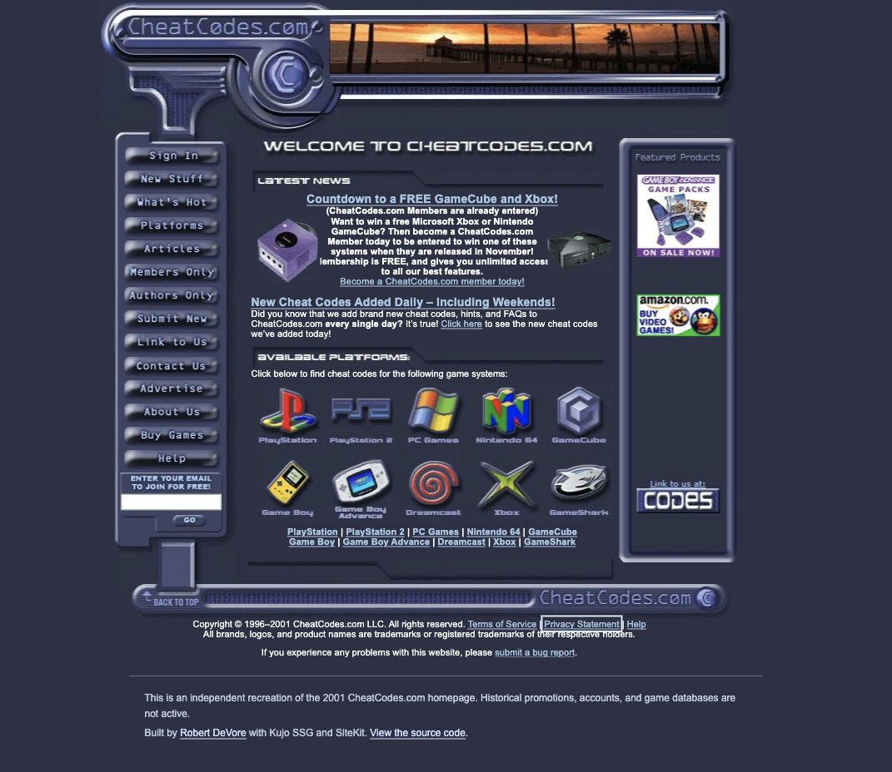

# CheatCodes.com — 2001, rebuilt with Kujo

A demo recreation of the CheatCodes.com homepage from 2001, built with [Kujo SSG](https://github.com/kujolang/ssg) and [SiteKit](https://github.com/kujolang/site-kit).

Chrome buttons. Console logos. A sunset over the pier. This project brings a piece of early gaming web design back to the browser, with readable mobile layouts, keyboard-friendly dialogs, and a fast static build.

**[Visit the live demo](https://cheatcodes.robertdevore.com/) · [Explore Kujo](https://github.com/kujolang) · [View the PageSpeed report](https://pagespeed.web.dev/analysis/https-cheatcodes-robertdevore-com/vog71rnqv7)**

[](https://cheatcodes.robertdevore.com/)

*Screenshot of the live demo, captured October 18, 2026.*

## A small showcase for the Kujo ecosystem

The brief was simple: recreate a supplied image of a 2001 website and make it work as a modern static page. The result shows how Kujo's tools fit together in a real, inspectable project.

| Tool | Its role in this demo |
| --- | --- |
| [Kujo](https://github.com/kujolang/kujo) | Runs the site's build program. |
| [Kujo SSG](https://github.com/kujolang/ssg) | Generates the site from local templates, assets, and configuration. |
| [SiteKit](https://github.com/kujolang/site-kit) | Supplies the design-system foundation, with a custom silver-and-navy theme for cards, buttons, controls, and scrollbars. |
| [Howl](https://github.com/kujolang/howl) | Turns a small Kujo example and project metadata into shareable SVG, HTML, and Markdown showcase files. |

The browser receives static HTML, CSS, images, and a small JavaScript file. It needs no application server or client-side framework. The source, build steps, and generated output all live in this repository.

Want to build something of your own? Start with [Kujo SSG](https://github.com/kujolang/ssg), pair it with [SiteKit](https://github.com/kujolang/site-kit), and give it a visual style worth remembering.

## What the demo includes

- The original desktop composition, including its metallic frame, navigation, ads, and console artwork.
- Live HTML news copy and labeled controls. The supplied reference image provides the decorative artwork through CSS sprites.
- A mobile layout that reflows text and controls instead of shrinking the desktop page to unreadable sizes.
- Wide, responsive dialogs with chrome-styled close buttons, visible keyboard focus, Escape dismissal, and focus return.
- Matching form controls and scrollbars.
- Canonical and social metadata, a sitemap, a custom 404 page, and structured data that identifies the page as a recreation.

This is an independent design demo, not the original CheatCodes.com service. The historical giveaways are over. Member accounts, game databases, and newsletter subscriptions are not connected. The signup demonstration does not send or save email addresses.

## Performance, with evidence

The live site scored **100 in all four PageSpeed Insights categories on both mobile and desktop** on October 18, 2026.

| Category | Mobile | Desktop |
| --- | ---: | ---: |
| Performance | 100 | 100 |
| Accessibility | 100 | 100 |
| Best practices | 100 | 100 |
| SEO | 100 | 100 |

[Open the measured report](https://pagespeed.web.dev/analysis/https-cheatcodes-robertdevore-com/vog71rnqv7). These scores describe that run; they are not a promise that every future run will return the same result.

The build keeps the page light by inlining only the SiteKit styles it uses, avoiding downloaded fonts, and preloading the WebP artwork. A [dated SEO and AI-search audit](seo-audit/2026-10-18/executive-summary.md) preserves the before-and-after evidence. Search rankings, traffic, and AI citations were not measured, and no gains in those areas are claimed.

## Run it locally

Install the [Kujo CLI](https://github.com/kujolang/kujo) and Node.js 22.19 or later. This project was built with Kujo 1.5.0 and includes Kujo SSG 1.2.0 and SiteKit 1.1.0. Python 3 is needed only for the preview command below.

```sh
git clone https://github.com/robertdevore/cheatcodes-retro.git
cd cheatcodes-retro
npm ci
npm run build
npm run check
python3 -m http.server 8080 --directory dist
```

Open [localhost:8080](http://localhost:8080/). Stop the preview server with `Ctrl+C`.

`npm run build` runs the Kujo generator, then prepares the output for GitHub Pages. `npm run check` checks the site's JavaScript syntax.

## Find your way around

| Path | What to edit or inspect |
| --- | --- |
| `templates/page-home.html` | Homepage structure and copy. |
| `templates/layout.html` | Document shell, metadata, and asset references. |
| `assets/style.css` | Retro theme, desktop layout, mobile layout, and dialogs. |
| `assets/app.js` | Navigation panels and form demonstrations. |
| `assets/sitekit/` | Vendored SiteKit distribution and licenses. |
| `kujo-ssg.yml` | Generator settings and site URL. |
| `build.kujo` | Vendored Kujo SSG build program. |
| `scripts/finalize.mjs` | CSS reduction, static hosting files, and final output cleanup. |
| `dist/` | Generated website, committed for deployment. |
| `howl.json` and `showcase/` | Showcase source metadata and rendered artifacts. |
| `seo-audit/2026-10-18/` | Audit reports, baseline, and verification receipts. |

Edit the source templates and assets, then rebuild. Avoid editing `dist/` by hand: the next build replaces it.

## Build the Howl showcase

With [Howl](https://github.com/kujolang/howl) installed and available on your `PATH`, run:

```sh
npm run howl
```

This validates `howl.json` and renders the card, share copy, and gallery into `showcase/`. These files are promotional materials; they are separate from the deployed website.

## Publish a change

Commit the source changes and rebuilt `dist/`, then push to `main`. The [GitHub Pages workflow](.github/workflows/pages.yml) publishes the committed output.

The live site uses `cheatcodes.robertdevore.com`, with a DNS-only Cloudflare CNAME pointing to `robertdevore.github.io`. GitHub Pages manages the certificate and enforces HTTPS.

If you fork the demo for another domain, update `kujo-ssg.yml`, the metadata in `templates/layout.html`, and the URLs and CNAME written by `scripts/finalize.mjs`. Update `howl.json` and this README as well. The `.openai/hosting.json` file records an earlier private deployment and is not used by the GitHub Pages workflow.

## Credits and reuse

Recreated by [Robert DeVore](https://robertdevore.com/) to showcase [Kujo SSG](https://github.com/kujolang/ssg), [SiteKit](https://github.com/kujolang/site-kit), and [Howl](https://github.com/kujolang/howl).

The original design, artwork, brand names, and console logos belong to their respective owners. This project does not claim ownership of those materials or affiliation with CheatCodes.com.

The vendored tools retain their own licenses: [Kujo SSG](LICENSE-SSG), [SiteKit](assets/sitekit/LICENSE), and the [bundled font](assets/sitekit/fonts/DepartureMono-LICENSE.txt). Those licenses do not grant rights to the historical artwork.
